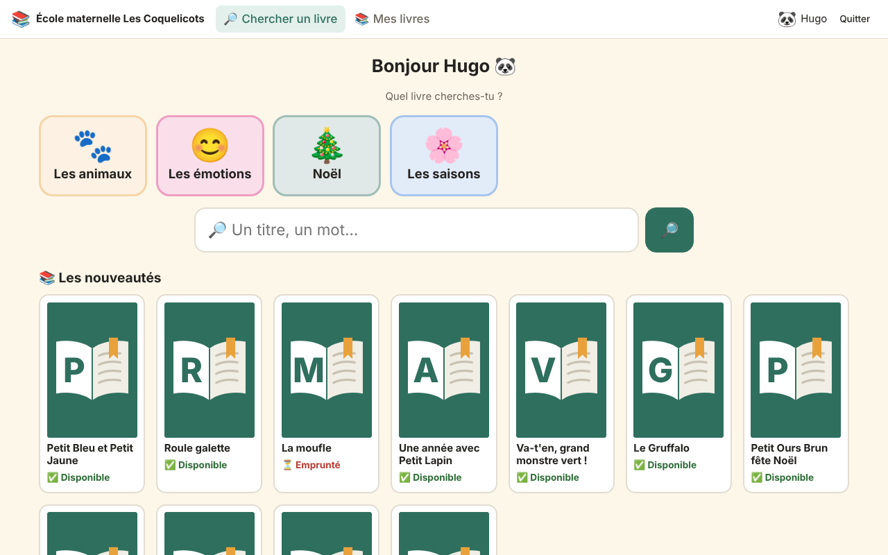
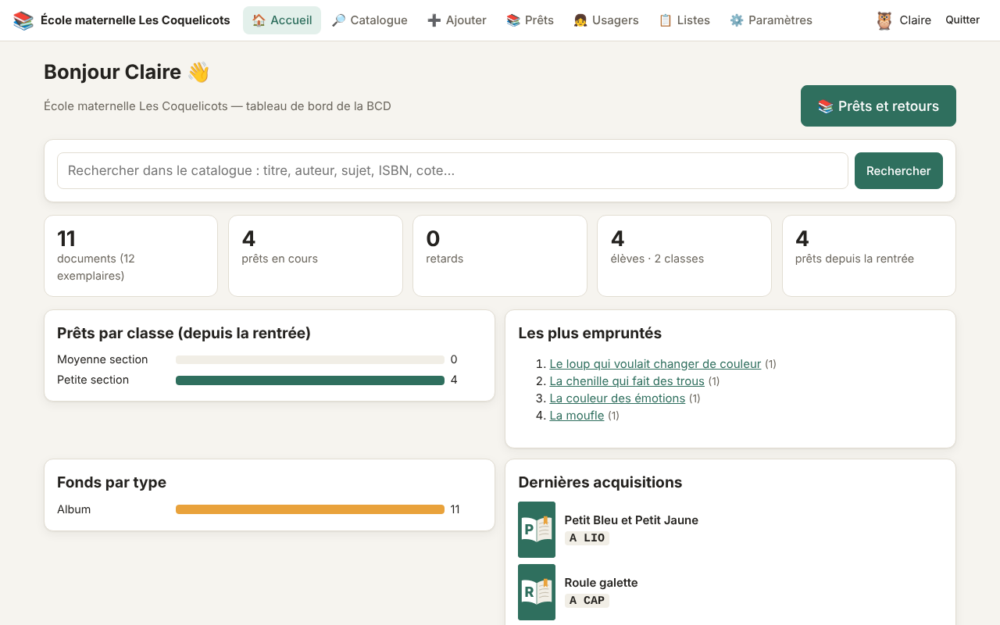
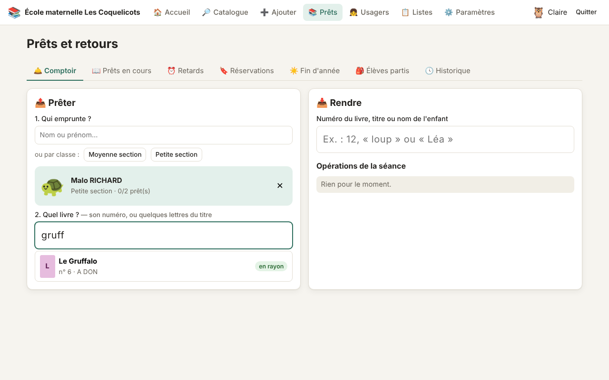
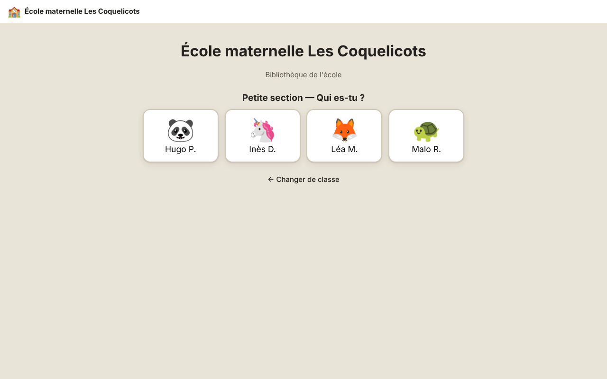
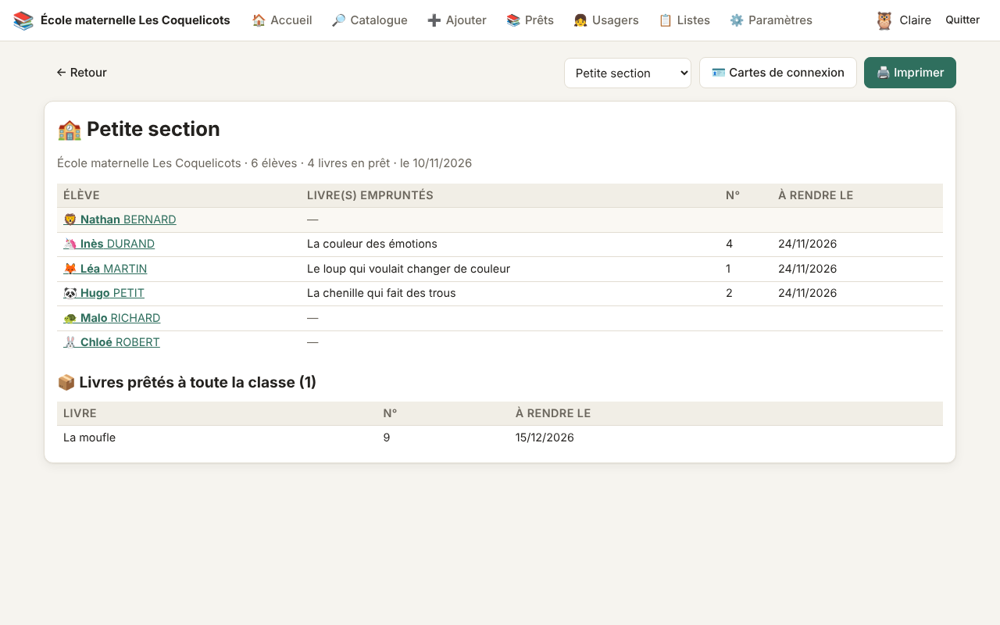
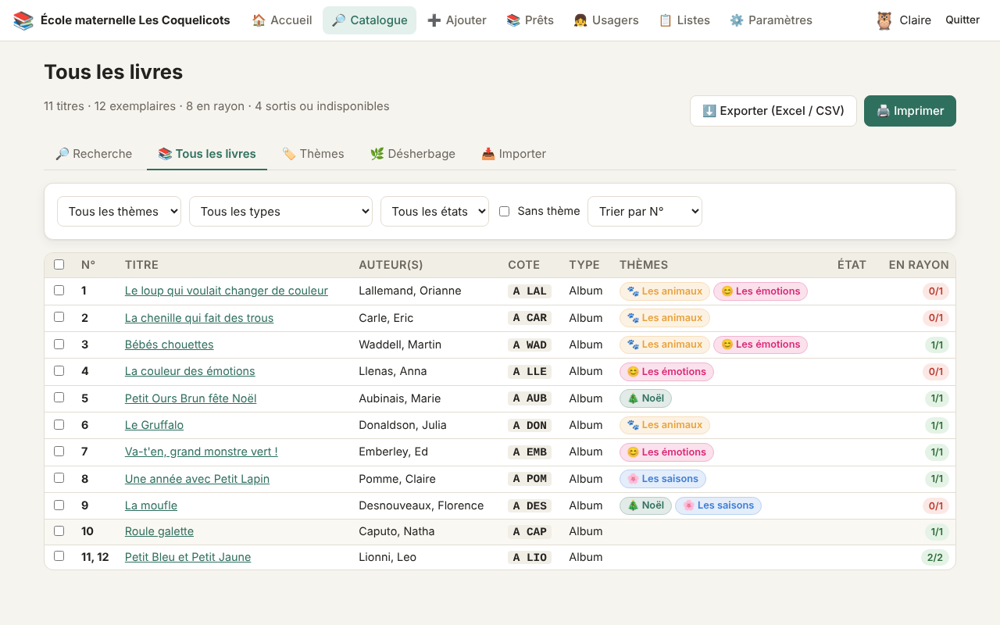
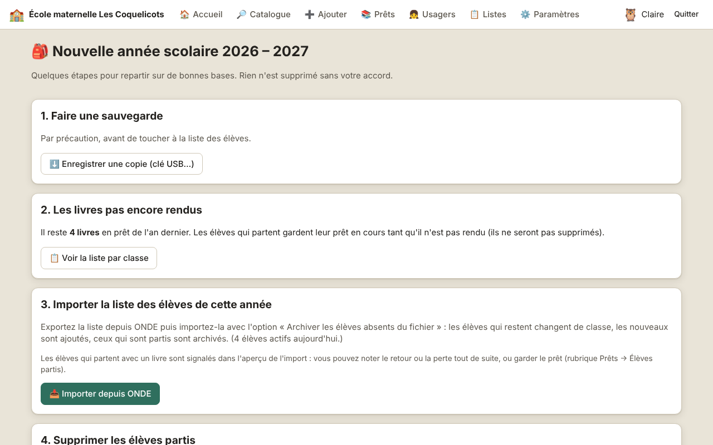

<p align="center"></p>

<h1 align="center">BCD</h1>

<p align="center"><b>La bibliothèque de l'école, simplement.</b><br>
Gérez les livres, les prêts et les élèves de votre BCD — pensée pour la maternelle et l'élémentaire.<br>
Gratuite, en français, sans abonnement, et les données restent sur l'ordinateur de l'école.</p>

<p align="center"></p>

---

## ✨ En bref

| | |
|---|---|
| 📚 **Catalogue** | Ajout d'un livre en tapant son ISBN : la fiche arrive de la **BnF**. Cote calculée automatiquement, numéro d'exemplaire simple (1, 2, 3…), couverture, thèmes, mots-clés. |
| 🛎️ **Prêts** | Comptoir **sans douchette** : on touche l'avatar de l'enfant, on tape le numéro ou le titre du livre. Retards, réservations, prêt à toute une classe, fin d'année. |
| 🧒 **Élèves** | Import depuis **ONDE**, connexion par **avatar** (sans mot de passe), thèmes en gros boutons, avis en frimousses 😍🙂😐. |
| 💾 **Sécurité** | Sauvegarde à chaque fermeture, copie sur **clé USB**, assistant de rentrée. Rien n'est envoyé sur Internet (sauf l'ISBN pour trouver la notice). |
| 🪟 **Windows** | Un installateur, ou un **zip sans installation** pour les PC qui bloquent les installations. Rien d'autre à installer. |

## 📥 Télécharger et installer

Les fichiers sont fabriqués **et testés sur Windows** automatiquement à chaque nouvelle version :
onglet **[Releases](../../releases)** (versions publiées) ou **Actions** → dernière exécution « Application Windows » → **Artifacts**.

| Fichier | Pour qui ? |
|---|---|
| `Installer-BCD-x.y.z.exe` | Cas général : double-clic, **sans droits administrateur**. Une icône BCD apparaît sur le bureau. |
| `BCD-x.y.z-sans-installation.zip` | PC qui refuse les installations (PC de mairie…) : dézipper n'importe où puis lancer `BCD.exe`. |

> Windows peut afficher « Windows a protégé votre ordinateur » (application non signée) :
> cliquer sur *Informations complémentaires* puis *Exécuter quand même*.

Au premier lancement, l'application demande le nom de l'école et crée le compte administrateur.

## 🖼️ Aperçu

<table>
<tr>
<td width="50%"><br><sub><b>Tableau de bord</b> — prêts en cours, retards, statistiques</sub></td>
<td width="50%"><br><sub><b>Comptoir</b> — l'enfant par son avatar, le livre par son titre ou son numéro</sub></td>
</tr>
<tr>
<td><br><sub><b>Connexion des élèves</b> — sa classe, puis son avatar</sub></td>
<td><br><sub><b>Fiche classe</b> imprimable — qui a quel livre</sub></td>
</tr>
<tr>
<td><br><sub><b>Tous les livres</b> — l'inventaire complet, à imprimer ou exporter</sub></td>
<td><br><sub><b>Assistant de rentrée</b> — import ONDE, élèves partis, classes vides</sub></td>
</tr>
</table>

## 🧰 Toutes les fonctionnalités

### Catalogue
- **Notices prêtes à l'emploi par ISBN** : catalogue de la **BnF**, complété par Open Library et Google Books
  (couverture, résumé). Doublons détectés, accents abîmés corrigés automatiquement.
- **Couverture** : si aucune source n'en a, photo ou image du PC (ou collée avec Ctrl+V), conservée hors ligne.
- **Cotes calculées automatiquement** : genre + 3 lettres de l'auteur (`A RAM`, `R DAH`, `BD AST`…),
  indice Dewey pour les documentaires (`590 LED`).
- **Numéros d'exemplaire simples** (1, 2, 3…), affichés en grand à l'enregistrement pour les écrire sur le livre.
- **Thèmes** (image, couleur, visibles ou non par les élèves) et **mots-clés**.
- **Recherche** simple (sans se soucier des accents) et avancée ; **Tous les livres** : inventaire complet.
- **Import d'un catalogue existant** : Hibouthèque (*Administration → Document → Export des documents en CSV*),
  BCDI, PMB, tableur. Colonnes reconnues automatiquement, aperçu avant import, numéros d'origine conservés.
- **Désherbage** par lots, **listes thématiques** et **étiquettes** à imprimer, export Excel (CSV).

### Prêts
- Comptoir **avec ou sans douchette** : numéro, titre ou ISBN du livre ; retour par numéro, titre ou nom de l'enfant.
- **Prêt à toute une classe** (lot de livres), **réservations** (par un adulte ou « Je le veux ! » de l'élève),
  livre mis de côté au retour.
- **Retards** par classe et **mots aux familles** imprimables ; **fin d'année** : listes par classe et date de retour commune.
- Durées et limites par profil, prolongations, déclaration de perte.

### Élèves et classes
- **Import ONDE** (ou CSV) avec aperçu : nouvelles classes, changements de classe, élèves partis archivés.
- **Fiche classe** et **fiche élève** imprimables, avec le **carnet de lecteur** de l'année.
- Connexion des élèves **sans mot de passe** : classe → avatar → code secret en pictogrammes (facultatif) ;
  **cartes de connexion** imprimables.
- Espace élève pensé pour la maternelle : thèmes en gros boutons, couvertures, « Mes livres »,
  **avis en frimousses** et rayon « Coups de cœur ».
- Profils **administrateur**, **enseignant**, **élève**.

### Sécurité des données
- Les données restent **sur l'ordinateur** (`Documents\BCD`), rien n'est ouvert sur le réseau.
- **Sauvegarde automatique** à chaque fermeture (15 gardées), **copie sur clé USB**, restauration en un clic.
- **Assistant de rentrée** : suppression des données des élèves partis (RGPD).
- Copie de sécurité avant chaque mise à jour de l'application.

Le détail des nouveautés de chaque version est dans le **[CHANGELOG](CHANGELOG.md)**.

## 🔄 Mises à jour

L'application vérifie au démarrage si une nouvelle version est publiée (*Paramètres → Version et mises à jour*).
Version installée : « Installer et redémarrer » ; version zip : lien vers la page de téléchargement.
Les données sont toujours conservées.

> La vérification automatique nécessite un dépôt GitHub **public** ; avec un dépôt privé,
> on télécharge les nouvelles versions à la main.

## 🛠️ Pour les développeurs

Il suffit de **Node.js 22.13 ou plus récent** (base SQLite intégrée, aucune dépendance côté serveur).

```bash
npm start          # version web : http://localhost:3000 (données dans data/bcd.sqlite)
npm test           # tests automatiques
npm install        # puis…
npm run app        # application de bureau (Electron)
npm run dist:win   # fabriquer l'installateur et le zip Windows (sous Windows)
```

Variables : `PORT`, `BCD_DB` (chemin de la base). Derrière un proxy : `NODE_USE_ENV_PROXY=1 HTTPS_PROXY=… npm start`.

Publier une version : changer `version` dans `package.json`, compléter le `CHANGELOG.md`,
puis créer une étiquette `vX.Y.Z` (`git tag v1.3.0 && git push --tags`) : GitHub fabrique, teste et publie les fichiers.

```
electron/            application de bureau (fenêtre, menu, sauvegardes, mises à jour)
server/              API HTTP (Node.js)
  routes/            catalogue, prêts, usagers, thèmes, listes, administration
  notice.js          notices BnF / Open Library / Google Books
  catalog-import.js  import Hibouthèque / CSV / XML
  cote.js            calcul des cotes
  backup.js          sauvegardes, clé USB, restauration
public/              interface (HTML, CSS, JavaScript)
test/                tests automatiques (node:test)
docs/captures/       captures d'écran (données fictives)
```
